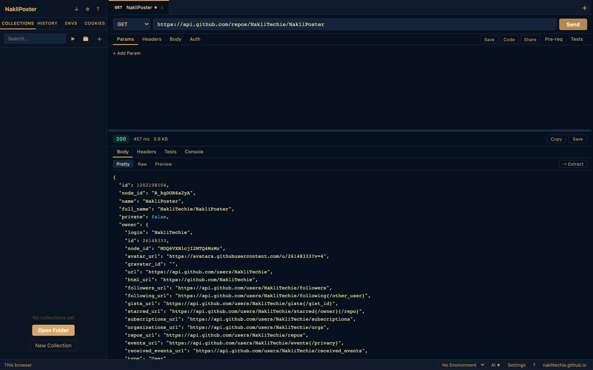

<h1 align="center">NakliPoster</h1>

<p align="center"><strong>Your own API tester, in one HTML file: REST, GraphQL and WebSocket requests, with collections saved as plain JSON on your disk.</strong></p>

<p align="center">One HTML file. Any modern browser. No account, no server, no telemetry.</p>

<p align="center">
  
  
  
</p>

<p align="center"></p>

## Install

| Where | How |
|---|---|
| Browser | Open [nakliposter.naklitechie.com](https://nakliposter.naklitechie.com) |
| NakliOS | Open NakliPoster on the [naklios.dev](https://naklios.dev) desktop |
| Your machine | `git clone https://github.com/NakliTechie/NakliPoster && cd NakliPoster && python3 -m http.server` |

Paste a URL, press **Send**, and read the response. This request needs no setup and returns JSON:

```
GET https://api.github.com/repos/NakliTechie/NakliPoster
```

No build step, no npm, no account. To keep your work, press **Open Folder** and pick a directory.

## Why

Your API keys, request history and collections are yours, and you want them on your own machine. You want to test an endpoint without installing a desktop app or signing in first.

NakliPoster is a static page. Requests go from your browser straight to the API you call, and your collections are Postman v2.1 JSON files in a folder you choose.

The limit is CORS. A browser blocks responses from an API that does not send `Access-Control-Allow-Origin`, so server-to-server APIs and internal services need a proxy, as described below.

## Bring your collections

Import a Postman v2.1 collection, a cURL command or an OpenAPI 3.x file. Export any collection as `.postman_collection.json`, so you can leave whenever you want. Imports drop pre-request and test scripts, so a shared collection cannot run code in your browser.

Write pre-request scripts and Chai-style tests against a `pm` object, then run a whole collection in order with the Collection Runner. Scripts run in an isolated worker with no access to the app or its storage.

## Share a request without a server

**Share** puts a request or collection into the URL `#fragment`, which browsers do not send to servers. Add a passphrase to encrypt it with AES-256-GCM, and send the passphrase through a separate channel. Secret-tagged environment variables stay out of shared links by default.

## When an API blocks the browser

Run a local proxy and point NakliPoster at it:

```bash
npx local-cors-proxy --proxyUrl https://api.example.com
```

For an API you control, add `Access-Control-Allow-Origin` to its responses.

## Commands

```
⌘K / Ctrl+K                      # search collections, history and URLs
window.nakliposter               # JavaScript API; enable in Settings → Developer
  .importCollection(json)        # add a Postman v2.1 or OpenAPI collection
  .listCollections()             # list loaded collections
  .exportCollection(id)          # return a collection as Postman v2.1 JSON
```

Other tabs and the "Send to NakliPoster" bookmarklet can push collections in through `postMessage`, and each one passes the same import parser.

## Verify it yourself

```bash
node scripts/test-naklios-storage.mjs   # NakliOS Folder and Crate workspaces, autosave
node scripts/test-security.mjs          # script sandbox, import stripping, message origins
```

Both lanes read `index.html` and check these contracts in its source, on every push through `.github/workflows/test.yml`. To check where your data goes, open your browser's Network panel. The page loads two libraries from jsDelivr when it opens, and after that a request sends traffic only to your API.

## License

MIT. [Guide](GUIDE.md) (every feature, sharing format, architecture, security model) · Part of the [NakliTechie series](https://naklitechie.github.io)
